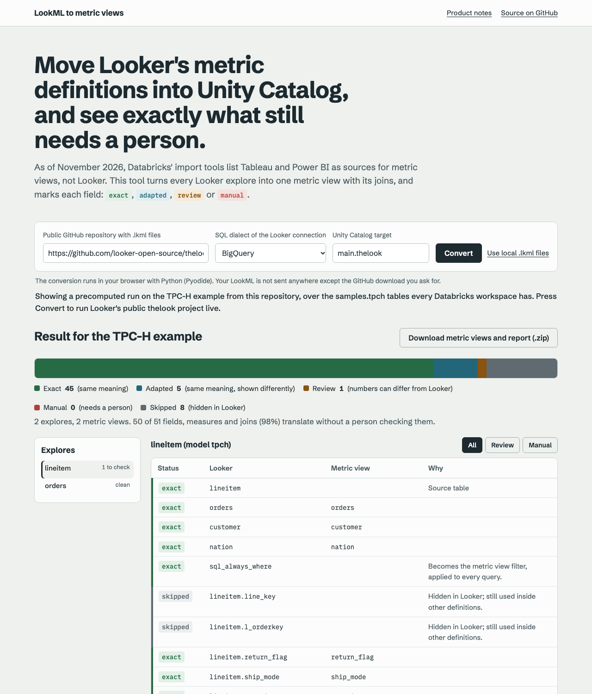

# LookML to metric views

As of November 2026, Databricks' import tools list Tableau and Power BI as sources for Unity Catalog metric views, not Looker. A Looker team on Databricks has to rebuild its definitions by hand or let Genie work on raw tables.

This tool reads a LookML project and writes one metric view per explore, with the explore's joins, dimensions and measures. For every field, measure and join it says whether it translated exactly, was adapted, needs review or needs a person, and why.

**Try it in the browser:** https://lookml-metric-views.bot-pulse.workers.dev (the conversion runs locally with Python in WebAssembly, nothing is uploaded)



## What you get

For a project folder or a public GitHub repository it writes:

| File | What it is |
|---|---|
| `metric_views/<model>__<explore>.yaml` | Metric view definition (YAML spec 1.1) |
| `create_metric_views.sql` | `CREATE OR REPLACE VIEW ... WITH METRICS` statements for all explores |
| `reconcile.sql` | Queries to compare totals with Looker before anything is switched off |
| `report.md`, `report.json` | Every item with its status and the reason |

| Status | Meaning |
|---|---|
| Exact | Same meaning, mechanical translation |
| Adapted | Same meaning, value shown differently (for example yesno becomes a boolean) |
| Review | Translated, but numbers can differ from Looker. The reason says when |
| Manual | Not translated, needs a person |

## Usage

```bash
pip install "lookml-metric-views[dialects] @ git+https://github.com/JuliusPetersen/lookml-metric-views"

# A local LookML project whose Looker connection is Databricks
lookml-metric-views ./my-looker-project --catalog main --schema looker

# A public repository on BigQuery, with tables mapped to Unity Catalog
lookml-metric-views https://github.com/looker-open-source/thelook \
  --dialect bigquery --table-map "*=main.thelook.*"
```

Then run `create_metric_views.sql` in a SQL warehouse and compare `reconcile.sql` with the same explores in Looker.

## Decisions

- **One metric view per explore, not per view.** People query explores, and the explore is where Looker defines joins. A converter that works per view loses them.
- **Rules, not a language model.** The same project gives the same output every time, so it can run in CI and be reviewed like code. The report is a ready task list for a person or a model to finish the manual items.
- **Flag instead of guess.** Anything that can change a number is marked review, with the reason.
- **SQL translation only for LookML snippets.** Looker on Databricks already writes Spark SQL. For BigQuery, Snowflake or Redshift projects each snippet is translated with sqlglot, and `${...}` references are kept intact.

## What testing changed

I created the generated metric views in a Databricks Free Edition workspace and compared every measure with SQL that reproduces Looker's results (`scripts/live_check.py`).

- **Sums over joined views.** Looker counts each joined row once (symmetric aggregates). A metric view counts it once per row of the base table. On TPC-H the order value measure in the order lines explore came out at 4.9 times Looker's value. The first version marked it exact. It is now marked review, and the other 15 measures match exactly.
- **Subqueries.** Databricks accepts subqueries that refer to a joined table but rejects correlated subqueries on the base table (`UNRESOLVED_COLUMN source.id`). The tool marks exactly that case as manual. After the change all five metric views from Looker's thelook project were created without edits (`scripts/deploy_check.py`).

## What public Looker projects need

On 25 Nov 2026 I ran the converter on 42 public Looker projects from Google's looker-open-source organisation (`scripts/survey.py`, only counts are stored). 224 explores became 135 metric views. Of 29,248 fields, measures and joins, 81% translate without a person. In the median project it is 72%. One large project holds 36% of the items, and without it 71% translate. 8 of the 42 projects gave no metric view at all, mostly because their base views use Liquid or native derived tables.

The largest blocker is Liquid templating. 46% of the items that need a person use it, and a metric view has no templating. Next come BigQuery UNNEST joins (992 items) and dimensions of one-to-many joins, which a metric view can't expose as fields (878). Most of these projects are BigQuery blocks, so UNNEST weighs more here than for a team already on Databricks.

## Not translated yet

Liquid templating, Looker parameters, access filters, extends and refinements of explores (views are handled), sets in field lists, fiscal timeframes, native derived tables, and display formats. Each shows up in the report as manual with its reason.

## Not validated yet

- The reference numbers come from SQL I wrote to reproduce Looker's logic, not from a Looker instance.
- I don't know how many Databricks customers run Looker, so the size of the problem is open.
- I haven't talked to analytics engineers who run Looker on Databricks yet. The problem is supported by public evidence, not by interviews.
- Timezone conversion depends on Looker connection settings, which a LookML project doesn't contain. Use `--timezone-conversion` to flag time fields.

## Development

```bash
python -m venv .venv && .venv/bin/pip install -e ".[dev]"
.venv/bin/pytest                         # 25 tests on the hard cases
python scripts/live_check.py --profile <databricks-profile> --warehouse <id>
python scripts/survey.py --out web/data/survey.json <owner/repo> ...
python scripts/build_web.py              # copies the package into web/ for the browser version
```

The example in `examples/tpch` is my own LookML over the `samples.tpch` tables that every Databricks workspace has.

## Sources

1. Databricks blog, Genie One Accuracy: Why Curated Agents Need Governed Context, 19 Nov 2026.
2. Databricks docs, Use metric views with external BI tools, and blog, Bulk migrate your dashboards to AI/BI with Genie Code, 19 Nov 2026.
3. Databricks docs, Unity Catalog metric views, YAML reference (spec 1.1) and joins.
4. Looker docs, LookML reference: explores, joins, symmetric aggregates.

Independent project based on public documentation. Not affiliated with or reviewed by Databricks or Google. Built with Claude Code.

Julius Petersen, MSc student at Nova SBE, Lisbon. [LinkedIn](https://www.linkedin.com/in/julius-petersen-is)
